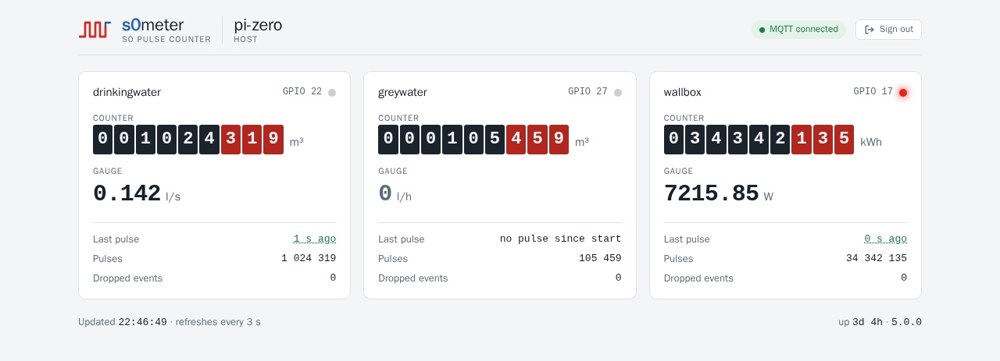

# s0meter – Deutsche Kurzfassung

🇬🇧 [Full documentation in English](README.md)

  

**s0meter zählt die S0-Impulse von Strom-, Wasser- und Gaszählern auf einem Raspberry Pi und zeigt sie
live an.**

Fast jeder Stromzähler und viele Wasser- und Gaszähler haben einen **S0-Impulsausgang** nach
DIN 43864: ein kurzer Impuls pro Wh oder Liter. An einen GPIO-Pin eines Raspberry Pi angeschlossen
(ein Pi Zero reicht), macht s0meter daraus Zählerstände:

- **Zählerstand** und aktuelle **Leistung bzw. Durchfluss** pro Zähler,
- per **MQTT** bei jedem Impuls veröffentlicht, z. B. für Node-RED, Home Assistant oder ioBroker,
- live auf einer **eingebauten Webseite**, mit Zählwerk und einer Impuls-LED wie am Zähler,
- regelmäßig und bei jedem Herunterfahren gespeichert, ein Neustart behält den Zählerstand,
- über eine **HTTPS-REST-API** (TLS 1.3) für Skripte und Monitoring, mit einem eigenen Token je
  Aufrufer; s0meter speichert davon nur den SHA-256-Hash und schreibt ins Log, wer zugreift.

Keine Cloud, keine Datenbank: ein einzelnes Programm und eine YAML-Datei.

## In fünf Schritten

1. **Herunterladen:** Das Archiv für deinen Pi gibt es unter
   [Releases](https://github.com/womat/s0meter/releases/latest): `armv6` für Pi 1 und Zero,
   `armv7` für 32-Bit-Systeme, `arm64` für 64-Bit-Systeme.
2. **Installieren:** System-User `s0meter` anlegen, Programm und `config.yaml` nach `/opt/s0meter`
   kopieren, Zertifikat erzeugen. Alles gehört root außer `data/` mit den Zählerständen, der Dienst
   darf `etc/` nur lesen – wer Konfiguration oder Token-Datei schreiben kann, kann sich selbst
   einen Token eintragen.
3. **Konfigurieren:** `env: prod`, MQTT-Broker und einen Eintrag pro Zähler (GPIO, Impulse pro
   Einheit, Einheiten). Dann je Aufrufer einen Token anlegen, z. B.
   `sudo /opt/s0meter/bin/s0meter token add browser`; er wird nur dieses eine Mal angezeigt,
   siehe [Tokens](README.md#tokens).
4. **Anschließen:** S0+ an einen GPIO-Pin, S0− an GND. Nie eine Spannung an S0+ legen, die GPIOs
   vertragen höchstens 3,3 V. Bei langen Leitungen, Zählern im Verteiler oder einem S0-Kreis mit
   12–24 V besser über einen **Optokoppler** für galvanische Trennung, siehe
   [Wiring](README.md#with-an-optocoupler-galvanic-isolation) – mit Schaltplan für den PC817 und
   den Grenzen der Impulsfrequenz.
5. **Starten:** mit der Unit aus dem Archiv (`contrib/s0meter.service`, läuft abgeschottet), dann
   `https://<dein-pi>:8443/` im Browser öffnen und den Token eingeben.

**Von 6.x auf 7.0.0:** `apiKey` gibt es nicht mehr, stattdessen `tokenFile` und
`s0meter token add`; HTTPS nur noch mit TLS 1.3, `/ready` ist entfallen. Die Schritte stehen unter
[Upgrading to 7.0.0](README.md#upgrading-to-700).

Die genauen Befehle stehen im [Quick start](README.md#quick-start), alle Einstellungen unter
[Configuration](README.md#configuration).

## Lizenz

MIT, siehe [`LICENSE`](LICENSE).
